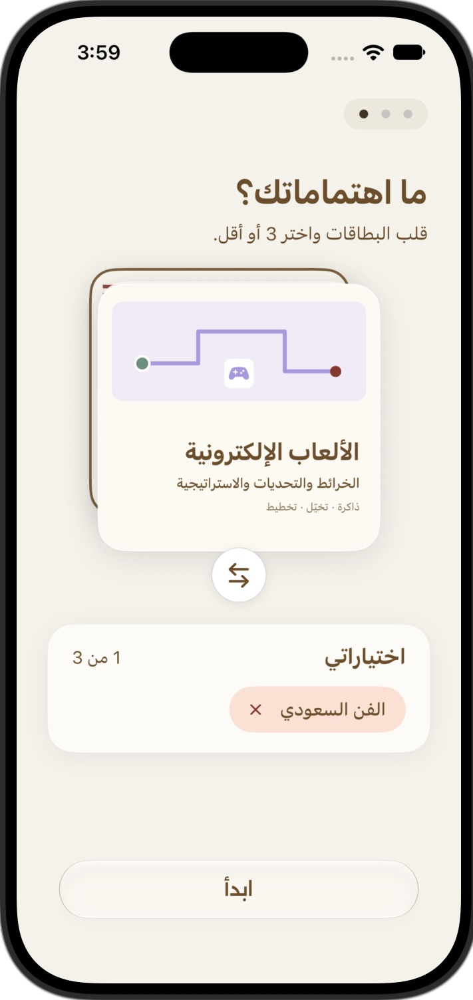
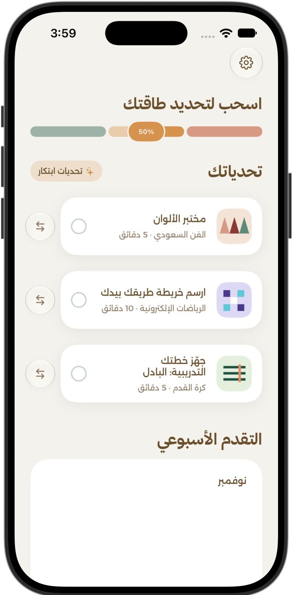
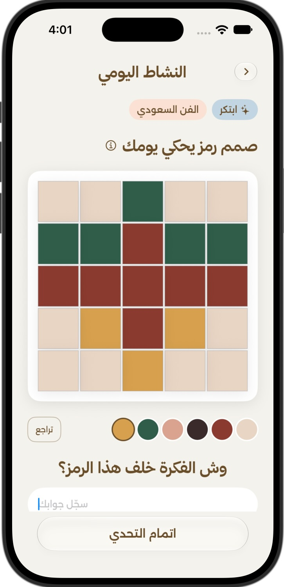
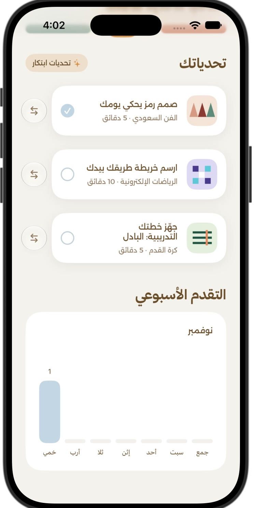

# Ludunah | لُدُونة

### Start Small. Stay Curious.

**An iOS app designed to support everyday cognitive engagement through short, interactive activities personalized to users' interests and self-reported energy levels.**

---

## About the Project

Ludunah was developed as part of our first Challenge Based Learning (CBL) project at Apple Developer Academy.

Our project explores **neuroplasticity**, the brain's ability to adapt and change through learning and experience.

We explored how everyday cognitive engagement could become more accessible, enjoyable, and adaptable to people's daily routines.

### Our Challenge

> Assist individuals in supporting neuroplasticity through everyday cognitive engagement.

### Our Solution

Ludunah introduces short cognitive activities tailored to users' interests and self-reported energy levels.

Rather than expecting users to follow the same routine every day, the app offers different activities depending on how they feel and what interests them.

The experience encourages users to start small, stay curious, and explore cognitive engagement through everyday activities.

---

## Key Features

### Interest-Based Personalization
Users can select their preferred interests:
- Art
- Sports
- Gaming

### Energy-Based Activities
Users select their current energy level, allowing the app to present activities suited to their available energy.

### Learn, Do & Create
Activities are organized into three engagement modes:

- **Learn:** Discover new information and concepts.
- **Do:** Apply knowledge through short practical tasks.
- **Create:** Explore creativity through interactive challenges.

### Interactive Challenges
Hands-on experiences include visual creativity, drawing activities, and cognitive challenges.

### Weekly Progress
Users can view their completed activities and follow their weekly engagement.

---

## App Walkthrough

### 1. Choose Your Interests

Users begin by selecting topics they enjoy, helping personalize their experience.

### 2. Set Your Energy Level

Users adjust their self-reported energy level, and Ludunah presents challenges tailored to their energy and selected interests.

### 3. Explore a Challenge

Each challenge introduces its purpose, estimated duration, and the cognitive skills it is designed to engage.

### 4. Engage in an Activity

Users interact directly with activities, including creating visual symbols using colors and a grid-based drawing canvas.

### 5. Track Your Progress

Completed challenges are reflected in the user's weekly activity progress.

## Source Code

Ludunah was collaboratively developed by Team 12 at Apple Developer Academy.

- **[View Source Code](https://github.com/LujainAwad/LudunahApp)** — My personal fork of the application, preserving its development history.
- **[Original Team Repository](https://github.com/athly1/LudunahApp)** — The original collaborative project repository.

This documentation highlights the project and my individual contributions, while crediting the entire development team.

---

## Design & Development

### Technologies Used

- Swift
- SwiftUI
- Xcode
- Git & GitHub
- Local Data Storage

### Development Process

**Challenge Based Learning → User Research → Ideation → UI/UX Design → iOS Development → Review & Iteration**

Our development process included:

- Conducting user interviews to better understand user needs.
- Exploring cognitive engagement and neuroplasticity.
- Brainstorming and refining potential solutions.
- Designing an Arabic-first user experience.
- Building interactive features using SwiftUI.
- Reviewing and improving the app throughout development.

---

## My Contributions

**Role: iOS Development & Interactive Features**

As a member of Team 12, I contributed to the design and development of Ludunah, focusing on interactive activities, reusable SwiftUI components, user experience improvements, and collaborative development.

### 1. Interactive Activity Development

- Implemented and refined Art activities across Learn, Do, and Create.
- Contributed to `PixelGridView`, an interactive drawing canvas that allows users to create visual symbols using a grid and color palette.
- Worked on activity interfaces, user interactions, and content presentation.
- Contributed to `CountdownTimerView` and `TimerEngine` to support timed activities.

### 2. Reusable SwiftUI Components

- Contributed to `PrimaryButton`, a reusable SwiftUI component that maintains consistent button styling and behavior across the app.
- Worked with SwiftUI concepts such as state management, view composition, and reusable components.

### 3. Weekly Progress

- Contributed to the Weekly Progress feature, which displays users' completed activities through a weekly visualization.

### 4. User Experience Improvements

- Contributed to onboarding navigation, allowing users to move forward and backward between screens.
- Refined activity interactions and completion flows to improve usability.

### 5. Git & Team Collaboration

- Used Git and GitHub to manage and share development work.
- Worked with feature branches and collaborated on integrating changes.
- Resolved merge conflicts while preserving existing work.

### Key Learnings

Through Ludunah, I strengthened my understanding of:

- Swift and SwiftUI development
- State management and interactive views
- Reusable UI components
- Structuring activity-based features
- Translating user needs into functional experiences
- Git workflows and collaborative software development

This project helped me connect user-centered design with hands-on iOS development, turning an initial idea into an interactive app prototype.

---

## Team

Developed collaboratively by **Team 12** at Apple Developer Academy.

- Lujain AlFrhan
- Reem Alharbi
- Athari Alotaibi
- Noha Alamri
- Ghadi Alharbi

Ludunah is a collaborative team project. This repository serves as a personal documentation showcase highlighting the project and my individual contributions. It is not the original team source-code repository.

---

## Project Note

Ludunah is an educational prototype exploring everyday cognitive engagement. It has not been clinically validated to improve neuroplasticity.

---

*Built with curiosity at Apple Developer Academy.*

**Start Small. Stay Curious.**
